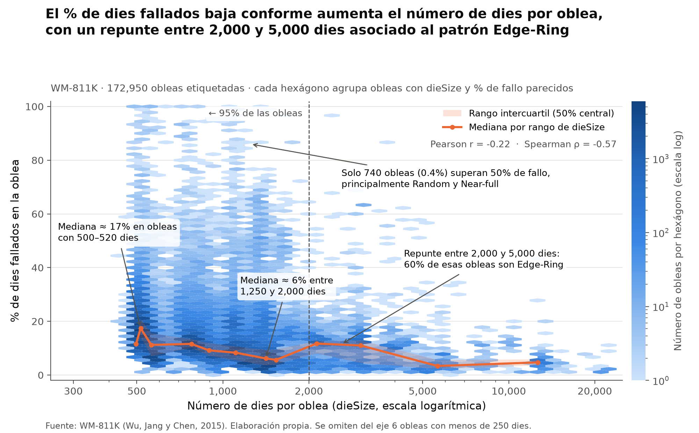

# WaferPi · Visualización de defectos en obleas semiconductoras (WM-811K)

Proyecto de la materia **Visualización de Datos** — Maestría Profesionalizante en Inteligencia Artificial, Instituto Tecnológico de Aguascalientes (TecNM).
**Autor:** Ing. Bryan Guadalupe De la paz Coronado · **Profesor:** Dr. Ricardo Emmanuel Reyes Acosta

> **Pregunta analítica:** ¿es posible distinguir visualmente el tipo de patrón de falla de una oblea a partir de la distribución espacial de sus dies fallados?

Este repositorio es la base visual del proyecto de tesis **WaferPi** (clasificación de patrones de falla en obleas y despliegue en Raspberry Pi 5).

---

## Resultados

| Tipo | Visualización | Archivo / enlace |
|---|---|---|
| Estática (matplotlib) | Número de dies por oblea vs % de dies fallados | [`figures/final_estatica_diesize_vs_fallo.png`](figures/final_estatica_diesize_vs_fallo.png) |
| Interactiva (Plotly) | Mapas de oblea por patrón (menú, hover, zoom) | [Ver en línea](https://bryan-ing.github.io/waferpi_visual/figures/final_interactivo_mapas_oblea.html) · [`figures/final_interactivo_mapas_oblea.html`](figures/final_interactivo_mapas_oblea.html) |
| BI (Tableau Public) | Dashboard: KPIs, obleas y % de fallo por patrón, filtros | [Ver en Tableau Public](https://public.tableau.com/app/profile/bryan.de.la.paz/viz/WaferPi-PatronesdefallaWM-811K/Dashboard1) · [`Dashboard Tableau/wafer_dashboard.twbx`](Dashboard%20Tableau/wafer_dashboard.twbx) |
| EDA (Avance 2) | Univariada, bivariada, multivariada y condicional | [`figures/`](figures/) (`avance2_*.png`) |



---

## Estructura del repositorio

```
waferpi_visual/
├── README.md                     ← este archivo
├── requirements.txt              ← versiones exactas de las librerías
├── notebooks/
│   └── waferpi_avance3.ipynb     ← TODO el flujo: carga → limpieza → EDA → visualizaciones finales → exportación BI
├── data/
│   ├── README.md                 ← fuente del dataset y transformaciones aplicadas
│   ├── LSWMD.pkl                 ← dataset original (NO se sube; se descarga de Kaggle)
│   └── processed/
│       └── obleas_etiquetadas.csv  ← tabla por oblea para Tableau (generada por el notebook)
├── figures/                      ← figuras generadas por el notebook
├── Dashboard Tableau/
│   └── wafer_dashboard.twbx    ← dashboard de Tableau empaquetado (incluye extracción de datos)
└── docs/
    └── guia_tableau.md           ← pasos para construir el dashboard de Tableau
```

---

## Cómo reproducir el proyecto

### 1. Requisitos
- **Python 3.11** (o 3.10). pandas 1.5.3 no tiene versión para Python 3.12 o superior.
  En Windows se descarga de https://www.python.org/downloads/ (marca *Add Python to PATH*).
- ~4 GB de RAM libres y ~3 GB de disco (el dataset pesa 2.1 GB).

### 2. Clonar el repositorio y crear el entorno
```bash
git clone https://github.com/Bryan-ing/waferpi_visual.git
cd waferpi_visual
py -3.11 -m venv .venv            # Windows   (Linux/Mac: python3.11 -m venv .venv)
.venv\Scripts\activate            # Windows   (Linux/Mac: source .venv/bin/activate)
pip install -r requirements.txt
```

### 3. Descargar el dataset
Descarga **WM-811K** de Kaggle (https://www.kaggle.com/datasets/qingyi/wm811k-wafer-map), descomprime y copia `LSWMD.pkl` en `data/`. Detalles en [`data/README.md`](data/README.md).

### 4. Ejecutar el notebook
```bash
jupyter notebook notebooks/waferpi_avance3.ipynb
```
Menú **Run → Run All Cells**. Tarda ~3 minutos (la carga del `.pkl` ocupa ~1 minuto). Al terminar, `figures/` y `data/processed/` quedan regenerados.

> **Error `No module named 'pandas.indexes'`:** estás usando pandas 2.x. Verifica que activaste el entorno `.venv` con Python 3.11 e instalaste `requirements.txt`.

---

## Decisiones de reproducibilidad
- **Datos originales intactos:** el `.pkl` solo se lee; todo lo derivado se guarda en `data/processed/`.
- **Sin pasos manuales:** limpieza, cálculos, figuras y exportación a Tableau están en el notebook.
- **Rutas relativas:** el notebook funciona en cualquier computadora sin editar rutas.
- **Selección aleatoria con semilla** (`random_state=42`) para los mapas de ejemplo.
- **Versiones fijas** en `requirements.txt`.
- **Cifras calculadas, no escritas:** todas las anotaciones de las figuras salen de los datos.

## Fuentes
- Wu, M.-J., Jang, J.-S. R., & Chen, J.-L. (2015). Wafer map failure pattern recognition and similarity ranking for large-scale data sets. *IEEE Transactions on Semiconductor Manufacturing, 28*(1), 1–12. https://doi.org/10.1109/TSM.2014.2364237
- Dataset en Kaggle: https://www.kaggle.com/datasets/qingyi/wm811k-wafer-map
